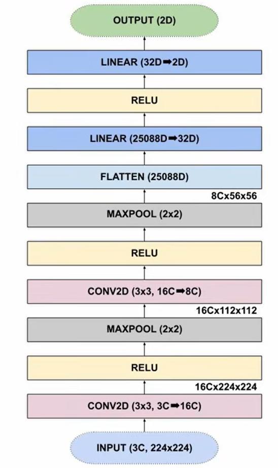

# Primi passi con PyTorch


Due notebook Jupyter per imparare le basi delle reti neurali con PyTorch: si parte da una semplice regressione e si arriva a un classificatore di immagini con reti convoluzionali e transfer learning.

| Notebook | Argomento |
|---|---|
| [`neural_network.ipynb`](neural_network.ipynb) | Tensori e prima rete neurale: regressione su dati numerici |
| [`ImageClassifier.ipynb`](ImageClassifier.ipynb) | Classificazione di immagini: riconoscere il mio gatto tra altri gatti |

## `neural_network.ipynb`: la prima rete neurale

Introduzione ai concetti di base, con un problema volutamente semplice: dati 14 valori di temperatura in ingresso (`X`) e i corrispondenti valori convertiti (`Y`), la rete deve imparare la relazione tra i due.

- **Tensori**: la struttura dati di PyTorch al posto delle liste.
- **Modello**: si parte dall'idea di un singolo neurone (`y = wx + b`) e si usa poi una piccola rete `Linear(1→10) → ReLU → Linear(10→10) → ReLU → Linear(10→1)`.
- **Addestramento**: loss `MSELoss`, ottimizzatore `Adam` (learning rate 0.01), 3000 epoche.
- **Risultato**: la loss scende da circa 590 a 0.44 e la rete, dato `70` in ingresso, prevede circa `21.16`.

## `ImageClassifier.ipynb`: riconoscere un gatto

L'obiettivo è una rete che, data la foto di un gatto, dica se è **il mio gatto** oppure **un altro gatto**. Il notebook è diviso in sezioni, ognuna con una spiegazione:

1. Import e percorso dei dati
2. La rete **CatClassifier**: una CNN con due blocchi convoluzione + ReLU + max pooling e due layer fully connected (architettura in [`CCN.png`](CCN.png))
3. Dataset e trasformazioni (`ImageFolder`, resize a 224×224)
4. Divisione train / validation (80% / 20%)
5. Addestramento di CatClassifier (15 epoche, Adam, `CrossEntropyLoss`)
6. Valutazione sul validation set: accuratezza, precisione, recall, matrice di confusione
7. **Transfer learning con ResNet18** pre-addestrata su ImageNet: cosa vuol dire, perché si sostituisce il layer `fc`, cosa succede ai pesi pre-addestrati durante il fine-tuning
8. Valutazione della ResNet e confronto con CatClassifier

<p align="center"></p>

### Risultati

Il dataset è molto sbilanciato (2111 foto di altri gatti contro 96 del mio), quindi l'accuratezza da sola è ingannevole: le metriche che contano sono precisione e recall sulla classe del mio gatto. Sullo stesso validation set (442 immagini, di cui 21 del mio gatto):

| | CatClassifier | ResNet18 (fine-tuning) |
|---|---|---|
| Accuratezza | 94.57% | 98.87% |
| Precisione | 20.00% | 100.00% |
| Recall | 4.76% (1 su 21) | 76.19% (16 su 21) |
| Falsi positivi | 4 | 0 |

La rete costruita da zero, con così pochi esempi, non riesce a riconoscere il gatto; la ResNet pre-addestrata sì.

### Dataset

Le immagini **non sono incluse** nel repository: si scaricano da Google Drive come [`dataset.zip`](https://drive.google.com/file/d/13qbs0Y6xzZCZsVG2nLBZGbBhveMfb65f/view).

Il notebook si aspetta che le immagini estratte si trovino in una cartella `drive` allo stesso livello della cartella del repository, con una sottocartella per classe:

```
ML/
├── code/            ← questo repository
└── drive/
    ├── 00_othercat/ ← foto di altri gatti   (etichetta 0)
    └── 01_marte/    ← foto del gatto da riconoscere (etichetta 1)
```

`ImageFolder` assegna le etichette in ordine alfabetico delle cartelle, per questo i prefissi `00_` e `01_`. Se usi un altro percorso, basta modificare `data_dir` nella prima sezione del notebook. [`marte_sofa.jpg`](marte_sofa.jpg) è una foto esterna al dataset, usata per provare le reti su una singola immagine.

## Come eseguire i notebook

Servono Python 3 e queste librerie:

```bash
pip install torch torchvision matplotlib scikit-learn pillow
```

Poi si aprono i notebook in VS Code o Jupyter e si eseguono le celle in ordine. L'addestramento gira su CPU: CatClassifier richiede pochi minuti, la ResNet18 parecchio di più. La prima volta i pesi pre-addestrati della ResNet (~45 MB) vengono scaricati automaticamente.

## Riferimenti

`ImageClassifier.ipynb` è stato realizzato seguendo il video **[Crea una AI che RICONOSCE IL TUO GATTO! Corso Pytorch Reti Neurali Convoluzione - Python AI - PART 1](https://www.youtube.com/watch?v=K0hhmD4VeTU)** del canale [PitoneProgrammatore](https://www.youtube.com/@PitoneProgrammatoreOfficial).
